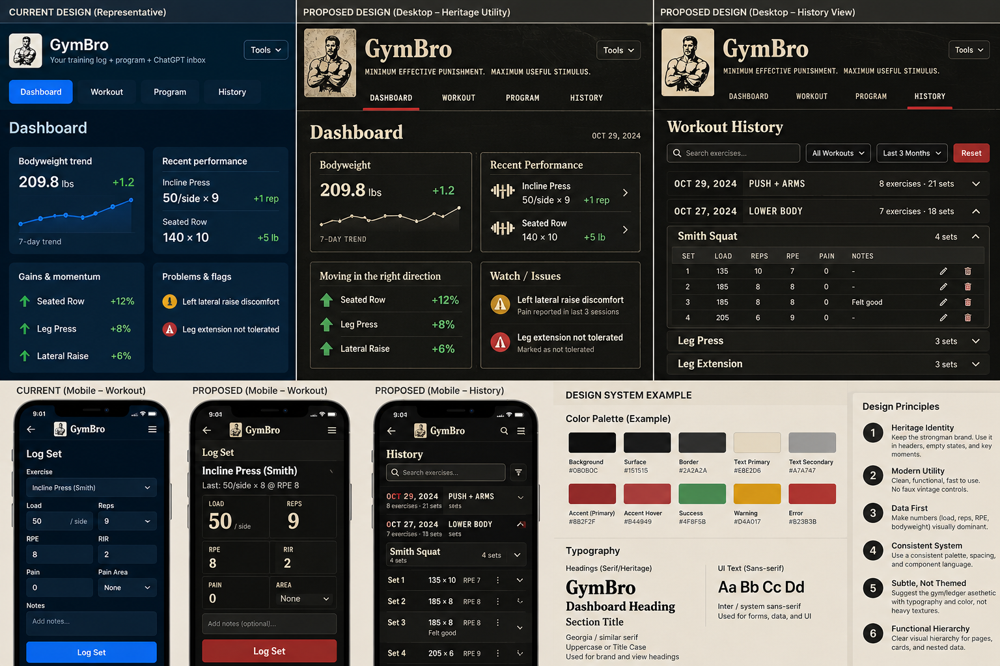

# GymBro brand and UI — Heritage Utility

This is the **current canonical visual-design authority** for GymBro, established by [issue #71](https://github.com/dnk1000/GymBro/issues/71). Future UI issues should say **“Follow docs/BRAND_AND_UI.md”**, then specify their bounded behavior/screen scope. Product requirements and approved subsystem architecture continue to govern product behavior, identity, persistence and data. Visual references do not authorize new features or change recorded facts.

## Directional reference

The approved board is **directional, not a pixel-perfect implementation contract**. It illustrates charcoal/ivory/warm-red hierarchy, selective heritage typography, strong numbers and restrained structure. It does not require its illustrated screens, tools menu, labels, filters, mock records, chart trends or coaching/medical interpretations. Do not copy decorative texture, condensed novelty controls or contrast combinations that impair readability. Adapt to the actual product and accessibility needs.

The committed PNG is an unchanged copy of the user-supplied `GymBro Heritage Utility Design Board.png` (SHA-256 `898ddd755ff869a193c12c285eaa91f3e58e8a04f753749b74acc00962b54a7b`). It is design provenance, not a second runtime or replacement logo asset.

## Product character and restraint

**Minimum effective punishment, maximum useful stimulus.** The interface follows the same principle: minimum ornamental friction, maximum useful information. Express competence and durability through hierarchy, spacing and deliberate dividers. Preserve the existing vintage strongman/woodcut logo and its accessible identity. Do not replace it with the board's illustrated variant.

Heritage belongs in the brand, selected major headings and occasional key moments. Controls, dense data and ordinary interaction remain modern. No parchment, leather, distressed controls, heavy texture, ornamental animation or external font dependency. Dashboard may carry more personality in a separately scoped issue. Active Workout is the least decorative surface: prioritize current exercise, previous performance, load/reps/RPE/RIR, clear log/complete actions and large phone targets. Do not change workflows or invent training prescriptions to match the board.

Prefer typography, spacing, dividers and indentation to repeated rounded containers. Use one panel for a meaningful region and inset detail only for a real nested relationship. Preserve existing layouts until their own approved issues; the shared-system foundation is not an app-wide screen rewrite.

## Reusable tokens

`styles.css :root` owns the runtime values below. Reuse tokens in CSS and canvas presentation; avoid a second palette in JavaScript. Color adjustments from the example board intentionally favor readable text, distinct semantics and focus visibility.

| Role | Token / current value |
| --- | --- |
| Page / panel / elevated | `--bg` #171716 / `--panel` #222220 / `--panel2` #2d2d29 |
| Input/chart/nested inset | `--surface-inset` #1b1b19 |
| Primary / supporting text | `--text` #f2eee5 / `--muted` #b9b4a9 |
| Heritage heading/brand | `--heritage` #f4e6ca |
| Primary / hover / pressed | `--accent` #91443f / `--accent-hover` #a25049 / `--accent-active` #763631 |
| Text on primary / warm indicator ink | `--on-accent` #fff8ed / `--accent-text` #e0a69e |
| Success / warning / error text | `--good` #9bc5a3 / `--warn` #dfc078 / `--bad` #e4a09a |
| Semantic badge backgrounds | `--good-surface` #28392d / `--warn-surface` #3c3423 / `--bad-surface` #452c2a |
| Structural / control boundary | `--line` #48473f / `--control-line` #817b71 |
| Keyboard focus | `--focus` #f4d9a3 |

Semantic colors accompany existing text/status labels; do not use color alone. Oxblood is a button fill; the lighter warm ink is appropriate for thin indicators and charts. Never replace a warning/error with the primary-action red merely to simplify the palette.

## Typography, numbers and geometry

| Decision | Shared rule |
| --- | --- |
| Brand / major headings | `--font-brand`: Georgia, Times New Roman, serif; wordmark and h2. No external font request. |
| UI / dense hierarchy | `--font-ui`: system-ui, Apple system, Segoe UI, Roboto, sans-serif; body, h3, buttons, forms, tables and detailed records. Code keeps monospace. |
| Sizes | Body 15 px / 1.45; h2 20 px; h3 15 px; supporting text 13 px. Existing narrow form text stays at least 16 px to avoid Safari focus zoom. |
| Data emphasis | KPIs 27 px desktop / 23 px narrow, weight 700; tabular numerals in metrics, tables, inputs, set/count summaries. Preserve all units, precision, zeros and missing-value distinctions. |
| Spacing | `--space-1` through `--space-6`: 4, 8, 12, 16, 24, 32 px. Shared grids/panels use the scale; contextual spacing is retained where it supports existing layout. |
| Corners | `--radius-control` / `--radius-detail`: 6 px; `--radius-panel`: 10 px; `--radius-pill`: full pill. Avoid nested rounding without structural meaning. |
| Depth | `--shadow-panel`: none. `--shadow-dialog`: restrained modal shadow; `--backdrop`: dark modal backdrop. Borders carry ordinary structure. |

## Components and states

- **Buttons:** oxblood/ivory primary; raised charcoal/text/divider secondary; destructive actions have semantic red boundaries. Enabled primary/secondary/destructive controls have deliberate hover feedback; primary pressed state darkens. Disabled state remains disabled and visibly muted. Do not change action priority or validation to achieve a visual effect.
- **Forms:** inset charcoal, stronger control border, inherited system typography, native dark color scheme. Inputs/selects/textareas retain 44 px minimum height, native affordances and existing labels; textareas remain resizable. Checkboxes retain native semantics and an accent tint.
- **Panels/notices/pills:** flat bordered panels, restrained inset items, semantic left-rule notices and status pills with readable foregrounds. Existing text explains status. Dialogs share the palette and receive the only material elevation.
- **Tables/History:** system sans and tabular numbers, clear muted column headings, consistent bottom dividers. Keep accepted desktop tables, phone stacked set details, original order, disclosure behavior and correction controls. A visual grouping must never fabricate session identity or change recorded facts.
- **Focus/selected/hover:** light 2 px keyboard outline with separation; disclosure outlines sit inside summaries so scroll containers do not clip them. Existing selected navigation uses a contrasting ivory label and warm underline, with matching `aria-current` state. Selection and position never imply workout completion. Hover must not be the only way to discover an action.

## Mobile navigation and header

Keep the strongman and wordmark recognizable, utilities reachable and header chrome minimal. A feature-inventory tagline is **not durable brand copy**. Prefer no persistent tagline or a quiet product-level line consistent with the North Star. Current accepted main includes the shared app shell from PR #76: an ivory wordmark, the quiet “Your training ledger” line, left brand/right utilities on desktop and a compact one-row phone header. This design authority preserves that accepted baseline; further screen changes require their own bounded issues.

Preserve the seven existing destinations and horizontally scrollable navigation. Shared controls have at least 44 px targets; current navigation buttons have 48 px targets and an inset keyboard-focus outline. Phone utility buttons stay on one row and the supporting tagline is hidden at widths up to 480 px. The footer separates the wrapping version label with a divider. No alternate menu or new navigation model is introduced by this authority.

Preserve accepted responsive breakpoints, single-column phone grids, local scroll containers and 16 px phone form text. Desktop History icon actions intentionally remain 28 px; the existing phone versions remain 44 px. Chart dimensions, contextual spacing, native control affordances, compact pills and existing screen-specific structures are intentional exceptions to blanket normalization. Avoid page-level overflow and keep focus visible when navigation scrolls.

## Verification and delivery

Change Level 1: presentation-only changes within existing behavior/architecture/data boundaries. Verify component states and contrast, desktop and 320/390 px layouts, all existing destinations and affected functionality with disposable data, relevant regression and syntax/release/diff checks, and the exact Vercel Preview/browser console. Responsive Chrome is not physical iPhone Safari evidence. Keep actual results, AC mapping, negative evidence and acceptance state in the focused PR's canonical completion report; this document defines design, not release acceptance.
